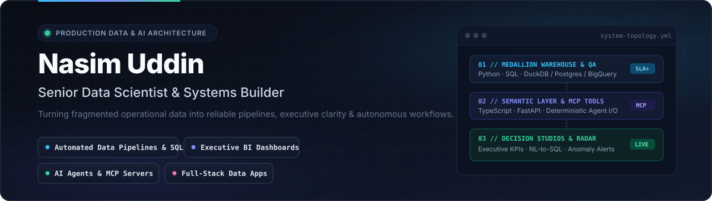

<div align="center">
  
</div>

<br />

I architect and ship **production-grade data pipelines, executive BI systems, and deterministic AI/MCP workflows** that replace fragile spreadsheets and manual reporting with reliable, automated engineering systems.

My focus is **end-to-end ownership**: from raw ingestion, schema contracts, and warehouse SQL optimization through to interactive KPI studios, anomaly detection radars, and full-stack internal tools that leadership teams rely on daily.

---

### What I Build

- **End-to-End Medallion Data Pipelines & Warehouse SQL** — Idempotent Bronze/Silver/Gold pipelines, automated data quality gates, reconciliation checks, and high-performance analytical SQL across DuckDB, PostgreSQL, and BigQuery.
- **Executive BI Studios & Decision Systems** — Sub-second KPI interfaces, cohort/retention/unit-economics models, and governed Natural-Language-to-SQL layers where every metric traces back to an auditable definition.
- **Production MCP Servers & AI Workflow Automation** — Strictly typed Model Context Protocol (MCP) servers, guardrailed tool-calling workflows, and automated operational triage systems with deterministic schemas and audit logs.
- **Full-Stack Data Applications & Anomaly Radars** — Custom FastAPI + Next.js/TypeScript operational apps, streaming/scheduled ingestion engines, and statistical anomaly detection for revenue and ops metrics.

---

### Featured Engineering Systems

| System | Architecture & Capabilities | Core Stack |
| :--- | :--- | :--- |
| **[`Nasim-U/metricpulse-bi`](https://github.com/Nasim-U/metricpulse-bi)** | **MetricPulse BI** — *Medallion Data Pipeline, Automated Data Quality Engine & Natural-Language SQL Executive Studio.* End-to-end Bronze → Silver → Gold analytical warehouse with schema/freshness QA gates, semantic metric governance, and a guardrailed NL-to-SQL executive interface. | `Python` `SQL` `DuckDB` `FastAPI` `Next.js` |
| **[`Nasim-U/opsflow-mcp`](https://github.com/Nasim-U/opsflow-mcp)** | **OpsFlow MCP** — *Production Model Context Protocol Server & Automated Analytics Workflow Kit.* Strictly typed MCP server exposing governed warehouse queries, anomaly diagnostics, and operational runbooks to AI agents with validation, rate controls, and structured telemetry. | `TypeScript` `Python` `MCP` `SQL` `CI/CD` |
| **[`Nasim-U/signalstream-hq`](https://github.com/Nasim-U/signalstream-hq)** | **SignalStream HQ** — *Full-Stack Revenue & Operations Anomaly Radar + Automated Ingestion Pipeline.* Scheduled & event-driven ingestion engine paired with baseline forecasting, multi-dimensional Z-score/IQR drift alerts, root-cause drilldowns, and an interactive ops command center. | `Python` `FastAPI` `PostgreSQL` `TypeScript` `React` |

---

### Tech Stack & Architecture Principles

```text
Data & Warehousing    :: Python (3.12+) · Advanced SQL · DuckDB · PostgreSQL · BigQuery · Parquet / Arrow
Pipelines & QA        :: Medallion Architecture · Schema Contracts · Idempotent Upserts · Automated Data Quality Gates
AI & Agent Systems    :: Model Context Protocol (MCP) · Structured Tool Calling · Guardrailed NL-to-SQL · Eval Harnesses
Backend & Full-Stack  :: FastAPI · TypeScript · Node.js · Next.js / React · REST & WebSockets
Ops & Reliability     :: GitHub Actions CI/CD · Pytest / Vitest · Docker · Structured Logging & Observability
```

#### Engineering Standards Every System Ships With
1. **Zero Silent Data Corruption** — Every pipeline enforces explicit schema validation, null/uniqueness assertions, and row-count reconciliation before promoting data downstream.
2. **Governed Metrics Over Ad-Hoc Queries** — Revenue, retention, SLA, and margin KPIs live in version-controlled SQL models—eliminating conflicting numbers across decks and dashboards.
3. **Deterministic Guardrails Around AI** — LLMs reason and orchestrate; validated SQL templates, read-only query sandboxes, and typed MCP tools execute.
4. **Turnkey Handover** — Reproducible environments, automated test suites, clear runbooks, and zero vendor lock-in.
